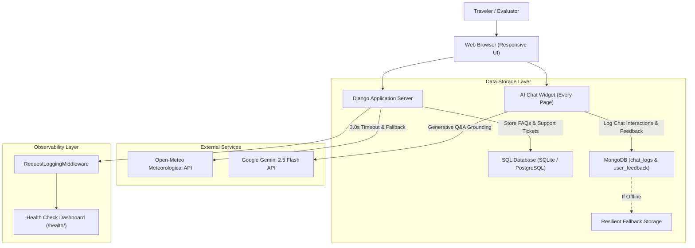

# ✈ WanderWise AI — Smart Travel Planner & AI Support Assistant

[](https://www.python.org/)
[](https://www.djangoproject.com/)
[](LICENSE)

An intelligent, full-stack travel planning platform and customer support website built with **Django**, **SQL**, **MongoDB**, **Google Gemini AI**, and live third-party meteorological APIs. WanderWise AI crafts tailored daily itineraries, budget allocations, packing checklists, and features an integrated AI Support Assistant on every page to answer frequently asked questions, explain application and HTTP error codes, and issue SQL-persisted support tickets.

---

## 🌐 Live Website & Repository Details

- **Live HTTPS Website URL:** [https://wanderwise-ai.onrender.com](https://wanderwise-ai.onrender.com) *(or your deployed Render service domain)*
- **GitHub Repository:** [https://github.com/akshayam1207-oss/WanderWise-AI](https://github.com/akshayam1207-oss/WanderWise-AI)
- **Submission Task Title:** Personal Travel Planning Website with Integrated AI Support Assistant & Observability

---

## 🚀 Key Feature Checklist (Assessment Requirements)

| Requirement | Implementation Details | Status |
| :--- | :--- | :---: |
| **At least 3 Distinct Pages** | • **Home / Planner (`/`)**<br>• **Dedicated FAQ Page (`/faq/`)**<br>• **Destinations Directory (`/destinations/`)**<br>• **System Health Monitor (`/health/`)**<br>• **Error Reference Guide (`/errors/`)**<br>• **Itinerary Plan (`/plan-trip/`)** | ✅ Fully Implemented |
| **Mobile Responsiveness** | Responsive CSS Grid and Flexbox layouts tested across mobile, tablet, and desktop viewports. | ✅ Fully Implemented |
| **AI Support Chat Widget on Every Page** | Floating `💬 Ask WanderWise AI` button on every page with chat history, quick chips, typing indicators, and markdown formatting. | ✅ Fully Implemented |
| **Minimum 10 FAQs in SQL** | 12 comprehensive FAQs stored in the SQL database (`FAQ` model) and dynamically rendered on the FAQ and Home pages. | ✅ Fully Implemented |
| **8 Required Error Codes** | Complete handling & simulation for `400`, `401`, `403`, `404`, `429`, `500`, `503`, and site-specific `WW-600`. | ✅ Fully Implemented |
| **Custom 404 & 500 Pages** | Branded purple design with prominent **"Ask the Assistant"** option that preloads error troubleshooting into the chat. | ✅ Fully Implemented |
| **AI Assistant Capabilities** | • Answers from SQL FAQ knowledge base<br>• Explains all 8 error codes<br>• Offers support ticket creation if question cannot be answered<br>• Optional Google Gemini Generative AI integration | ✅ Fully Implemented |
| **Support Tickets in SQL** | `SupportTicket` Django ORM model with unique ticket ID (`WW-TCK-XXXX`), status workflow, and admin management. | ✅ Fully Implemented |
| **Chat Logs & Feedback in MongoDB** | Connected via `pymongo` with automatic fallback to persistent local logs if MongoDB is offline or unconfigured. | ✅ Fully Implemented |
| **Request Logging Middleware** | Captures every HTTP request method, path, status, latency (ms), client IP, and maintains recent request log buffer. | ✅ Fully Implemented |
| **Health Check Page** | Real-time diagnostic dashboard at `/health/` and `/health/?format=json` verifying SQL DB, MongoDB, and external API SLAs. | ✅ Fully Implemented |
| **Third-Party API with Timeout & Fallback** | Open-Meteo Meteorological API with strict 3.0-second SLA limit and automated switch to local climate cache on timeout. | ✅ Fully Implemented |
| **Security & Environment Variables** | No secret keys or credentials in GitHub; configured via `.env` with `.env.example` provided. | ✅ Fully Implemented |

---

## 🛠️ Architecture & Data Storage



---

## ⚠️ Documentation of Required Error Codes

WanderWise AI provides dedicated error templates, automated unit testing, and an interactive testing center (`/errors/` and `/test-error/<code>/`):

| Error Code | Official Title | Type | Meaning in WanderWise AI | Resolution & Troubleshooting |
| :---: | :--- | :--- | :--- | :--- |
| **400** | Bad Request | Client Error | Occurs when budget or duration parameters are negative, missing, or malformed in the trip planner form. | Verify form fields, ensure total budget is positive and duration is at least 1 day. |
| **401** | Unauthorized | Authentication | Attempting to access private itineraries or staff administrative portals without valid authentication. | Log into your authorized WanderWise user or administrator account. |
| **403** | Forbidden | Authorization | The server understands the request but refuses access to restricted internal resources or settings. | Contact support if elevated administrative permissions are required. |
| **404** | Page Not Found | Client Error | Triggered when visiting non-existent URLs (e.g. `/this-page-does-not-exist/`) or expired trip links. | Return to `/` or use the **"Ask the Assistant"** option on the custom 404 page. |
| **429** | Too Many Requests | Rate Limiting | Triggered when too many trip generation queries are submitted in rapid succession. | Pause for 30–60 seconds before submitting another itinerary request. |
| **500** | Internal Server Error | Server Error | Unhandled server exception during backend itinerary compilation or database querying. | Automatically logged in `data/requests.log`. Click **"Ask the Assistant"** to file a ticket. |
| **503** | Service Unavailable | Server Capacity | Upstream generative AI providers or meteorological services experiencing temporary maintenance. | System automatically employs cached travel fallbacks; retry in 1–2 minutes. |
| **WW-600** | Plan Quota Exceeded | **Site-Specific** | Custom WanderWise application code indicating trip duration exceeds algorithm bounds (> 30 days). | Shorten trip duration (3–7 days recommended) or submit a custom group expedition ticket. |

---

## 🌦️ Third-Party API with Timeout & Fallback

WanderWise AI connects to the **Open-Meteo Meteorological Service** to fetch live temperature and weather conditions for destinations:
- **Strict SLA Timeout:** **3.0 seconds**.
- **Resilient Fallback Engine:** If the external network times out, connection is dropped, or rate limits are encountered, WanderWise catches `requests.exceptions.Timeout` and immediately serves cached, destination-specific climate estimates.
- **Interactive Verification:** Visit `/destinations/` and click **"Test Timeout Fallback (3.0s SLA)"** to test and verify the fallback mechanism.

---

## 💡 Proposed Improvement (Assessment Requirement)

> **Proposed Improvement:** **Offline-First PWA (Progressive Web App) Synchronization with IndexedDB and Background Service Workers**
>
> While WanderWise AI currently offers responsive styling, PDF downloads, and clipboard copying, travelers frequently lose cellular connectivity while on flights, remote mountain trails, or during international roaming. 
> 
> By transforming WanderWise into a Progressive Web App (PWA) with a Service Worker and client-side IndexedDB cache, travelers could view their full day-by-day itineraries, turn-by-turn attraction notes, and offline maps without an active internet connection. Offline chat messages and feedback would queue locally and seamlessly sync with the SQL database and MongoDB once connectivity is restored.

---

## 💻 Local Setup & Development Instructions

### 1. Clone Repository & Setup Environment
```bash
git clone https://github.com/akshayam1207-oss/WanderWise-AI.git
cd WanderWise-AI

# Create and activate Python virtual environment
python -m venv venv
# On Windows:
venv\Scripts\activate
# On Linux/macOS:
source venv/bin/activate

# Install dependencies
pip install -r requirements.txt
```

### 2. Configure Environment Variables
Copy the template `.env.example` to `.env`:
```bash
cp .env.example .env
```
Configure your keys inside `.env`:
- `SECRET_KEY`: Django secret key
- `DEBUG`: `True` for development, `False` for production
- `ALLOWED_HOSTS`: `*` or your production domain
- `GEMINI_API_KEY`: *(Optional)* Your Google Gemini API key from Google AI Studio
- `MONGO_URI`: *(Optional)* MongoDB connection string (defaults to local fallback storage)

### 3. Initialize SQL Database & Seed 12 FAQs
```bash
python manage.py makemigrations
python manage.py migrate
python manage.py seed_faqs
```

### 4. Run the Test Suite
Run the 10 automated test cases verifying pages, error codes, custom 404, SQL models, chat, and API fallbacks:
```bash
python manage.py test
```

### 5. Launch Development Server
```bash
python manage.py runserver
```
Visit `http://127.0.0.1:8000/` in your browser.

---

## 🚀 Live Deployment to Render (HTTPS)

1. Create a free account at [Render.com](https://render.com/).
2. Click **New +** → **Web Service** and connect your GitHub repository `akshayam1207-oss/WanderWise-AI`.
3. Configure the following settings:
   - **Environment:** `Python 3`
   - **Build Command:** `pip install -r requirements.txt && python manage.py migrate && python manage.py seed_faqs && python manage.py collectstatic --noinput`
   - **Start Command:** `gunicorn myproject.wsgi:application`
4. In **Environment Variables**, add:
   - `DEBUG`: `False`
   - `ALLOWED_HOSTS`: `.onrender.com,localhost,127.0.0.1`
   - `SECRET_KEY`: *(Generate a secure random string)*
   - `CSRF_TRUSTED_ORIGINS`: `https://*.onrender.com`
5. Click **Deploy Web Service**. Render will provision your live website with a free, automatic **HTTPS certificate**.

---

## 👨‍💻 Author & Submission
- **Student Name:** Akshaya M
- **Project:** WanderWise AI — Final Assessment in Software Development
